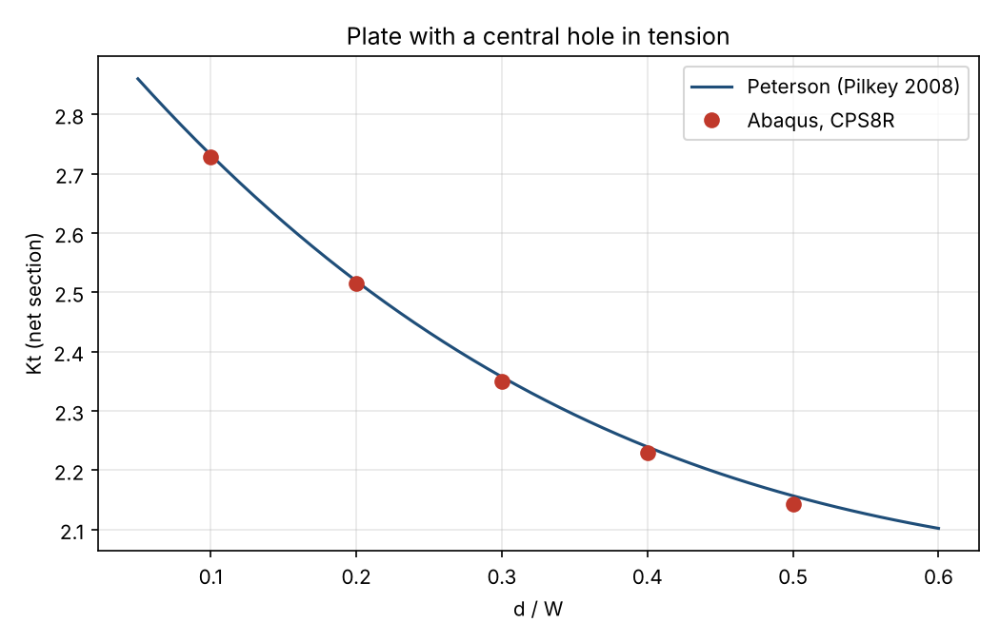
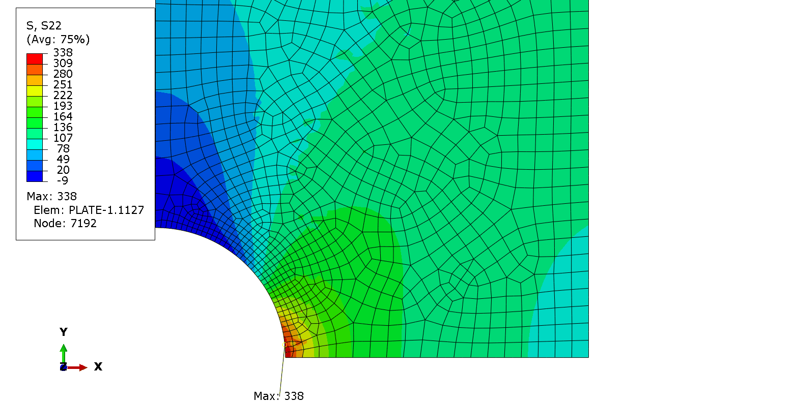

# Abaqus Python: parametric stress concentration study, validated against Peterson

A fully scripted Abaqus/CAE workflow: build the model from a parameter file, mesh it, run a parametric study, extract the results from the ODB and check them against a published reference. No clicking in the GUI, every result reproducible.

The test case is the classic finite-width plate with a central hole in tension. It is simple on purpose: the reference solution is known, so the workflow can be trusted before it is applied to real parts (brackets, lugs, welded details, bolted joints).





*S22 around the hole for d/W = 0.3. The peak is 338 MPa in the Abaqus/CAE display (75 % result averaging) and 335.6 MPa in the script, which averages the element-nodal values at the hole edge node. Both give Kt within 0.4 % of Peterson.*

## What the scripts do

| File | Role |
|---|---|
| `params.json` | Geometry, material, load, hole sizes and mesh settings |
| `plate_model.py` | Builds the quarter model (sketch, sets, section, mesh, step, BCs, load), runs the job, reads the ODB |
| `run_study.py` | Loops over d/W, then runs a mesh convergence check, writes CSV files |
| `compare_peterson.py` | Compares with Peterson, writes the table and the plot |

## Model

- Quarter model with symmetry on both axes, plane stress, linear elastic steel (E = 210 GPa, ν = 0.3)
- Plate W = 100 mm, L = 400 mm (L/W = 4, far from the hole), t = 10 mm
- Gross tension 100 MPa on the far edge
- 8-node quadratic elements (CPS8R), refined along the hole edge
- Kt (net section) = peak S22 at the hole edge / (σ · W / (W − d))

## Reference

Pilkey W.D., Pilkey D.F., *Peterson's Stress Concentration Factors*, 3rd ed., Wiley, 2008, central circular hole in a finite-width plate under uniaxial tension:

Kt,n = 2 + 0.284 (1 − d/W) − 0.600 (1 − d/W)² + 1.32 (1 − d/W)³

## Results

All five cases agree with Peterson within 0.7 % (largest error at d/W = 0.5). Full table and mesh convergence check: [results/summary.md](results/summary.md).

The mesh is free (unstructured), so Kt moves by about ±0.5 % between mesh levels instead of converging monotonically. A structured mesh around the hole would remove this scatter.

## How to run

```
abaqus cae noGUI=run_study.py
pip install matplotlib
python compare_peterson.py
```

Change any value in `params.json` (plate size, hole sizes, mesh density) and run again. Abaqus job files are written to `runs/`. Tested with an Abaqus release running Python 2.7. The code is written to be Python 3 compatible but has not yet been run on Python 3.

## Limits

Linear elastic, 2D plane stress, static load. The same workflow structure extends to 3D parts, plasticity, contact and fatigue post-processing.

## Author

Mohamed Lemine Baba Hmoudy, Mechanical Engineer (EUR-ACE accredited Master-level degree, ENIT). FEA and Abaqus automation for welded frames, brackets and bolted joints.

The scripts were written with the help of an AI coding assistant. The analyses were run and the results checked against the reference by the author.
