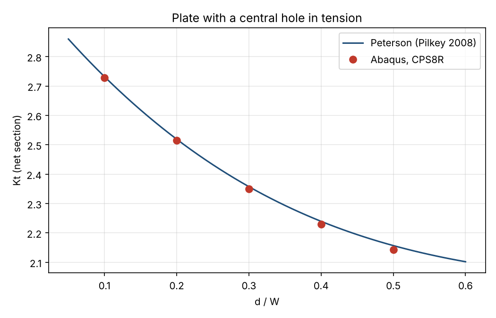
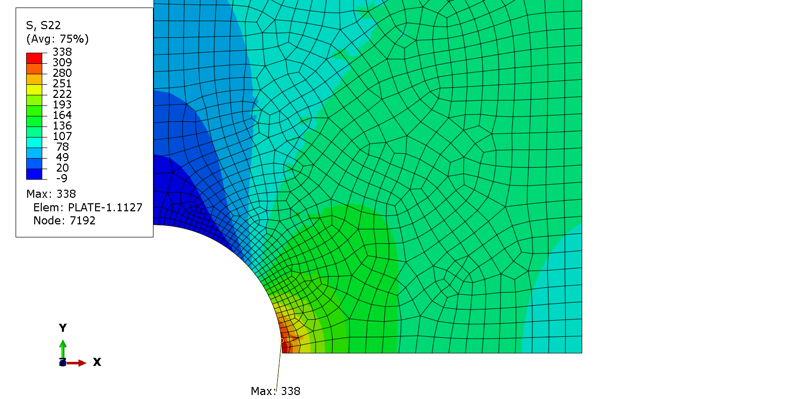

# Abaqus Python: parametric stress concentration study, verified against Peterson

A fully scripted Abaqus/CAE workflow: build the model from a parameter file, mesh it, run a parametric study, extract the results from the ODB and compare them with published references. No clicking in the GUI.

The test case is the classic finite-width plate with a central hole in tension. It is simple on purpose: the reference solution is known, so the workflow can be checked before the same scripting approach is used on real parts.





*S22 around the hole for d/W = 0.3. Kt is computed by the script from the element-nodal S22 values averaged at the hole-edge node (335.6 MPa). The value shown in the Abaqus/CAE legend depends on the display averaging setting and is not used.*

## What the scripts do

| File | Role |
|---|---|
| `params.json` | Geometry, material, load, hole sizes and mesh settings |
| `plate_model.py` | Builds the quarter model (sketch, sets, section, mesh, step, BCs, load), runs the job, reads the ODB |
| `run_study.py` | Loops over d/W, then runs a mesh sensitivity check, writes CSV files |
| `compare_peterson.py` | Compares with Peterson, writes the table and the plot |

## Model

- Units: mm, N, MPa.
- Quarter model, plane stress, linear elastic (E = 210 000 MPa, ν = 0.3). For this 2D traction problem Kt does not depend on E or ν.
- Plate W = 100 mm, full length L = 400 mm (L/W = 4); the quarter model is 50 × 200 mm, so the loaded edge is 2W from the hole. Thickness t = 10 mm (affects reactions only in plane stress).
- Boundary conditions: u1 = 0 on x = 0 (XSYMM), u2 = 0 on y = 0 along the ligament (YSYMM).
- Load: uniform gross tension 100 MPa on y = L/2, applied as a negative pressure.
- Mesh: free quad-dominated mesh, CPS8R (with CPS6M where the mesher needs triangles), global size 2 mm, 40 elements on the quarter arc for the parametric runs.
- Kt (net section) = peak S22 at the hole edge / (σ · W / (W − d)).

## References

1. Pilkey W.D., Pilkey D.F., *Peterson's Stress Concentration Factors*, 3rd ed., Wiley, 2008, central circular hole in a finite-width plate under uniaxial tension (curve fit):
   Kt,n = 2 + 0.284 (1 − d/W) − 0.600 (1 − d/W)² + 1.32 (1 − d/W)³
2. Heywood's approximation: Kt,n = 2 + (1 − d/W)³.

The two published fits differ from each other by 0.1 % to 1.5 % over d/W = 0.1 to 0.5.

## Results

Kt from the FEA agrees with Peterson within 0.7 % and with Heywood within 0.8 % for all five cases, i.e. within about 1 %, inside the spread between the two published references. Full table: [results/summary.md](results/summary.md).

Mesh sensitivity (d/W = 0.3, 10 to 80 elements on the arc): Kt scatters within about 1 % (2.339 to 2.361) and does not converge monotonically, because the mesh is free and only the arc seed changes. A structured, globally refined mesh with an extrapolated Kt is the next improvement; until then the agreement should be read as "within about 1 %", not better.

## How to run

```
abaqus cae noGUI=run_study.py
pip install matplotlib
python compare_peterson.py
```

Change any value in `params.json` (plate size, hole sizes, mesh density) and run again. Abaqus job files are written to `runs/`. Tested with Abaqus 2020 (Python 2.7).

## Limits

Linear elastic, 2D plane stress, static load. Through-thickness 3D effects (t/d from 0.2 to 1.0) are not captured. No reaction-force equilibrium check is reported yet.

## Author

Mohamed Lemine Baba Hmoudy, Mechanical Engineer (EUR-ACE accredited Master-level degree, ENIT).

The scripts were written with the help of an AI coding assistant. The model set-up, the mesh sensitivity check and the comparison with the published references were done and checked by the author.
